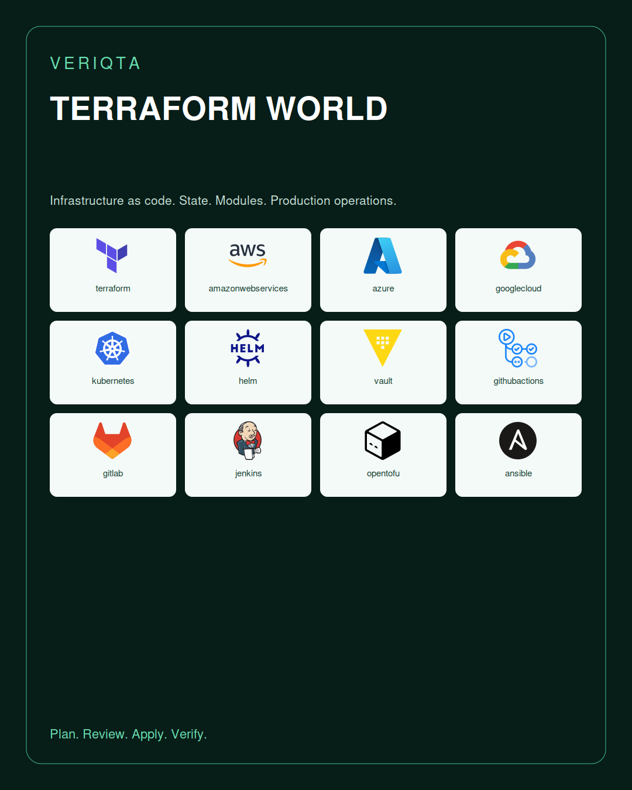
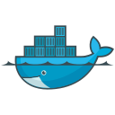
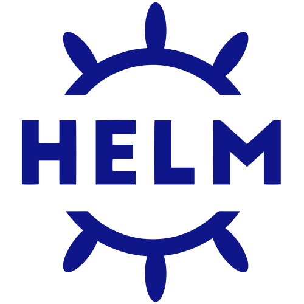
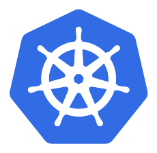
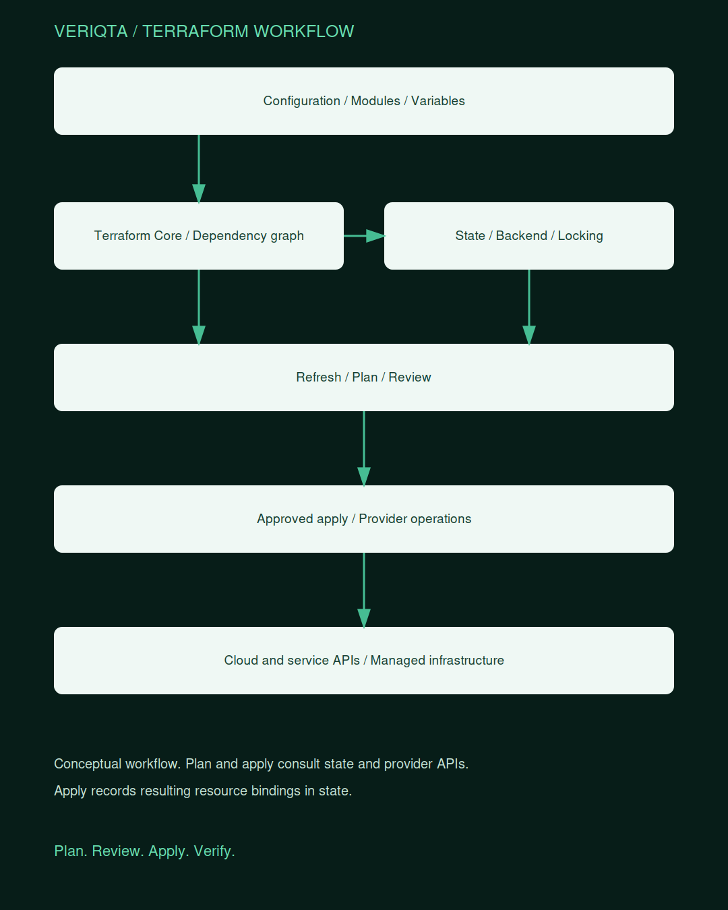

# TERRAFORM-WORLD

### Understand the configuration. Review the plan. Own the infrastructure.

TERRAFORM-WORLD is VERIQTA’s engineering hub for Terraform and infrastructure as code. Explore HCL, providers, modules, state, backends, planning, testing, security, cloud infrastructure, automation, and production operations.

**Scaffold edition.** The public README, navigation indexes, catalogues, and visual assets are available. Individual notes, labs, projects, interview materials, scripts, and configuration templates are intentionally empty. Empty templates are reserved destinations, not runnable infrastructure.

## Choose your path

| Goal | Start here |
|---|---|
| Learn Terraform | [Infrastructure as Code Foundations](02-Infrastructure-as-Code-Foundations/) |
| Write clear configurations | [HCL Syntax and Types](05-HCL-Syntax-and-Types/) |
| Build reusable modules | [Modules](10-Modules/) |
| Manage state safely | [State and Locking](12-State-and-Locking/) |
| Automate delivery | [CI CD and Automation](24-CI-CD-and-Automation/) |
| Investigate failures | [Troubleshooting and Incidents](28-Troubleshooting-and-Incidents/) |
| Prepare for interviews | [Interview Preparation](37-Interview-Preparation/) |

## Explore Terraform World

| Section | Topics |
|---|---|
| [00-Start-Here](00-Start-Here/) | How-to-Use, Learning-Paths, Lab-Environments, Compatibility, Costs-and-Cleanup, Evidence |
| [01-Beginner-to-Advanced](01-Beginner-to-Advanced/) | Junior, Mid-Level, Senior, Architect, Skills-Checklist |
| [02-Infrastructure-as-Code-Foundations](02-Infrastructure-as-Code-Foundations/) | Declarative-Configuration, Desired-State, Idempotence, Terraform-vs-Other-Tools, Resource-Lifecycle, IaC-Operating-Model |
| [03-Terraform-Architecture](03-Terraform-Architecture/) | Core, Providers, Graph, State, Plan, Apply, Plugin-Protocol, Dependency-Resolution |
| [04-Installation-and-CLI](04-Installation-and-CLI/) | Installation, Version-Management, CLI-Configuration, Init, Fmt, Validate, Plan, Apply, Destroy, Console, Show, Graph, Output, Providers, Test, Workspace, State, Import |
| [05-HCL-Syntax-and-Types](05-HCL-Syntax-and-Types/) | Blocks, Arguments, Identifiers, Comments, Primitive-Types, Collections, Objects, Tuples, Null, Unknown-Values, Type-Constraints, Optional-Attributes |
| [06-Variables-Locals-and-Outputs](06-Variables-Locals-and-Outputs/) | Input-Variables, Defaults, Validation, Variable-Precedence, Tfvars, Locals, Outputs, Sensitive-Values, Ephemeral-Values |
| [07-Expressions-and-Functions](07-Expressions-and-Functions/) | References, Operators, Conditionals, For-Expressions, Splat, Templates, Dynamic-Blocks, String-Functions, Collection-Functions, Encoding, Filesystem, Date-and-Time, IP-Network, Provider-Defined-Functions |
| [08-Resources-and-Data-Sources](08-Resources-and-Data-Sources/) | Managed-Resources, Data-Sources, Addresses, Dependencies, Count, For-Each, Provider-Meta-Argument, Lifecycle, Preconditions, Postconditions, Checks, Terraform-Data |
| [09-Providers-and-Registry](09-Providers-and-Registry/) | Provider-Requirements, Configuration, Aliases, Authentication, Version-Constraints, Dependency-Lock-File, Checksums, Mirrors, Provider-Cache, Registry-Trust |
| [10-Modules](10-Modules/) | Root-and-Child, Inputs-and-Outputs, Composition, Sources, Registry-Modules, Versioning, Provider-Inheritance, Module-Contracts, Examples, Documentation |
| [11-Module-Engineering](11-Module-Engineering/) | Repository-Structure, Naming, Validation, Reusable-Abstractions, Testing, Release-Process, Semantic-Versioning, Upgrade-Guides, Private-Registry |
| [12-State-and-Locking](12-State-and-Locking/) | State-Model, Resource-Bindings, Serial-and-Lineage, Refresh, Locking, State-Inspection, State-Commands, Sensitive-State, Recovery, Remote-State-Access |
| [13-Backends-and-Remote-State](13-Backends-and-Remote-State/) | Local, S3, AzureRM, GCS, Remote, Cloud-Integration, HTTP, Kubernetes, Backend-Configuration, Bootstrapping, Migration, Encryption, Access-Control |
| [14-Planning-and-Execution](14-Planning-and-Execution/) | Refresh, Unknown-Values, Saved-Plans, Plan-JSON, Apply-Approval, Parallelism, Replacement, Targeting-Tradeoffs, Destroy-Plans, Interrupted-Apply |
| [15-Lifecycle-Imports-and-Refactoring](15-Lifecycle-Imports-and-Refactoring/) | Create-Before-Destroy, Prevent-Destroy, Ignore-Changes, Replace-Triggered-By, Import-Blocks, CLI-Import, Moved-Blocks, Removed-Blocks, Resource-Renames, State-Migration |
| [16-Environments-and-Workspaces](16-Environments-and-Workspaces/) | CLI-Workspaces, HCP-Workspaces, Directory-Separation, Variable-Sets, Account-Separation, State-Boundaries, Promotion, Naming |
| [17-AWS-Infrastructure](17-AWS-Infrastructure/) | Identity, VPC, Compute, Load-Balancing, Storage, Databases, EKS, Serverless, Observability, Multi-Account, AWS-Provider-Compatibility |
| [18-Azure-Infrastructure](18-Azure-Infrastructure/) | Identity, Subscriptions, Resource-Groups, Networking, Compute, Storage, Databases, AKS, Key-Vault, AzureRM-and-AzAPI |
| [19-Google-Cloud-Infrastructure](19-Google-Cloud-Infrastructure/) | Projects, IAM, VPC, Compute, Storage, Databases, GKE, Cloud-Run, Service-Accounts, Provider-Compatibility |
| [20-Kubernetes-and-Application-Providers](20-Kubernetes-and-Application-Providers/) | Kubernetes-Provider, Helm-Provider, Cluster-Bootstrap, Manifest-Lifecycle, Secrets, CRDs, Provider-Readiness, Separation-of-Concerns |
| [21-Security-and-Secrets](21-Security-and-Secrets/) | Least-Privilege, OIDC, Dynamic-Credentials, Vault, Secret-Handling, Sensitive-vs-Ephemeral, Write-Only-Arguments, State-Exposure, Plan-Exposure, Supply-Chain |
| [22-Policy-and-Compliance](22-Policy-and-Compliance/) | Sentinel, OPA, Policy-Sets, Guardrails, Exceptions, Audit-Evidence, Tagging, Cost-Policies, Plan-Review |
| [23-Testing-and-Validation](23-Testing-and-Validation/) | Terraform-Test, Run-Blocks, Assertions, Mocks, Overrides, Checks, Integration-Tests, Terratest, TFLint, Security-Scanning, Test-Cleanup |
| [24-CI-CD-and-Automation](24-CI-CD-and-Automation/) | GitHub-Actions, GitLab-CI, Jenkins, Pull-Request-Plans, Approval-Gates, Apply-Serialization, Credentials, Drift-Detection, Artifacts, Rollback-Limits |
| [25-HCP-Terraform](25-HCP-Terraform/) | Organizations, Projects, Workspaces, Runs, VCS-Integration, Agents, Variable-Sets, Run-Tasks, Policy, Dynamic-Credentials, Private-Registry, API |
| [26-Terraform-Enterprise](26-Terraform-Enterprise/) | Deployment, Architecture, Authentication, Networking, Storage, High-Availability, Backup, Upgrades, Capacity, Operational-Support |
| [27-Terraform-Stacks](27-Terraform-Stacks/) | Components, Deployments, Provider-Configuration, Dependencies, Orchestration, State-Boundaries, Migration, Availability |
| [28-Troubleshooting-and-Incidents](28-Troubleshooting-and-Incidents/) | Provider-Errors, Authentication, State-Lock, Drift, Unexpected-Replacement, Dependency-Cycles, Unknown-Values, Import-Failures, Timeouts, Partial-Apply, State-Corruption, Rate-Limits |
| [29-Production-Operations](29-Production-Operations/) | Ownership, Runbooks, Change-Control, Break-Glass, Operational-Readiness, Drift, Upgrades, State-Backup, Disaster-Recovery, Incident-Response |
| [30-Performance-and-FinOps](30-Performance-and-FinOps/) | Graph-Size, Parallelism, Provider-Rate-Limits, State-Partitioning, Plan-Time, Cost-Estimation, Infracost, Tagging, Idle-Resources, Cleanup |
| [31-Provider-Development](31-Provider-Development/) | Plugin-Framework, Schemas, CRUD, Data-Sources, Plan-Modifiers, State-Upgrades, Import, Ephemeral-Resources, Actions, Acceptance-Tests, Publishing |
| [32-Advanced-Language-and-Workflows](32-Advanced-Language-and-Workflows/) | Ephemeral-Blocks, Write-Only-Arguments, Actions, Identity-and-Import, Provisioners, External-Data, Experimental-Features, Version-Gates |
| [33-Architecture-Patterns](33-Architecture-Patterns/) | Landing-Zone, Network-Platform, Application-Stack, Multi-Account, Multi-Region, Disaster-Recovery, Private-Platform, SaaS-and-Multi-Tenancy |
| [34-Migration-and-Ecosystem](34-Migration-and-Ecosystem/) | Legacy-Terraform, Provider-Upgrades, Module-Upgrades, Cloud-Migration, OpenTofu-Comparison, Terragrunt, Atlantis, Orchestration-Platforms, Compatibility |
| [35-Projects](35-Projects/) | Junior, Mid-Level, Senior, Portfolio-Capstones |
| [36-Labs](36-Labs/) | Junior, Mid-Level, Senior |
| [37-Interview-Preparation](37-Interview-Preparation/) | Junior, Mid-Level, Senior, System-Design, Production-Scenarios |
| [38-Engineer-Notebooks](38-Engineer-Notebooks/) | Standards, Evidence-and-Redaction, Junior, Mid-Level, Senior |
| [39-Toolkit-and-Templates](39-Toolkit-and-Templates/) | Root-Modules, Reusable-Modules, Tests, Backends, CI, Policies, Diagnostics, Cleanup |
| [40-Language-and-Resource-Catalog](40-Language-and-Resource-Catalog/) | Language-Constructs, Execution-Concepts, Cloud-Service-Patterns |
| [41-Provider-and-Tool-Catalog](41-Provider-and-Tool-Catalog/) | Provider-Directory, Selection, Compatibility, Integrations |
| [42-Resources-and-Certification](42-Resources-and-Certification/) | Official-Documentation, CLI-Reference, Language-Reference, Registry, Release-Notes, Terraform-Associate, Glossary |
| [43-Versioning-Governance-and-Lifecycle](43-Versioning-Governance-and-Lifecycle/) | Version-Matrix, Deprecations, Licensing, Module-Lifecycle, Ownership, Support, Feature-Availability |

## Language and resource catalogue

Terraform language constructs, execution concepts, and provider-managed infrastructure belong to different layers. Cloud service patterns below are conceptual categories, not exact Terraform resource type names.

| Category | Resources and concepts |
|---|---|
| [Language-Constructs](40-Language-and-Resource-Catalog/Language-Constructs/) | Terraform-Block, Provider-Block, Resource-Block, Data-Block, Module-Block, Variable-Block, Output-Block, Locals-Block, Lifecycle-Block, Check-Block, Import-Block, Moved-Block, Removed-Block, Ephemeral-Block, Action-Block |
| [Execution-Concepts](40-Language-and-Resource-Catalog/Execution-Concepts/) | Resource-Address, Resource-Instance, Dependency-Graph, Plan, State, Backend, Lock, CLI-Workspace, Provider-Configuration, Module-Instance |
| [Cloud-Service-Patterns](40-Language-and-Resource-Catalog/Cloud-Service-Patterns/) | Identity, Network, Subnet, Route, Firewall, Compute, Load-Balancer, Object-Storage, Database, Cluster, DNS, Certificate, Secret, Monitoring |

## Providers, modules, and workflows

Selected providers and module families cover common platform needs. Each provider defines its own resources, data sources, schemas, and version requirements. Module families are learning categories, not named published modules.

| Provider, module family, or workflow | Learning folder |
|---|---|
| Terraform CLI | [Explore](41-Provider-and-Tool-Catalog/Terraform-CLI/) |
| HCP Terraform | [Explore](41-Provider-and-Tool-Catalog/HCP-Terraform/) |
| Terraform Enterprise | [Explore](41-Provider-and-Tool-Catalog/Terraform-Enterprise/) |
| Terraform Stacks | [Explore](41-Provider-and-Tool-Catalog/Terraform-Stacks/) |
| AWS Provider | [Explore](41-Provider-and-Tool-Catalog/AWS-Provider/) |
| AzureRM Provider | [Explore](41-Provider-and-Tool-Catalog/AzureRM-Provider/) |
| AzAPI Provider | [Explore](41-Provider-and-Tool-Catalog/AzAPI-Provider/) |
| Google Provider | [Explore](41-Provider-and-Tool-Catalog/Google-Provider/) |
| Kubernetes Provider | [Explore](41-Provider-and-Tool-Catalog/Kubernetes-Provider/) |
| Helm Provider | [Explore](41-Provider-and-Tool-Catalog/Helm-Provider/) |
| Vault Provider | [Explore](41-Provider-and-Tool-Catalog/Vault-Provider/) |
| Random Provider | [Explore](41-Provider-and-Tool-Catalog/Random-Provider/) |
| TLS Provider | [Explore](41-Provider-and-Tool-Catalog/TLS-Provider/) |
| Local Provider | [Explore](41-Provider-and-Tool-Catalog/Local-Provider/) |
| HTTP Provider | [Explore](41-Provider-and-Tool-Catalog/HTTP-Provider/) |
| External Provider | [Explore](41-Provider-and-Tool-Catalog/External-Provider/) |
| TFE Provider | [Explore](41-Provider-and-Tool-Catalog/TFE-Provider/) |
| GitHub Provider | [Explore](41-Provider-and-Tool-Catalog/GitHub-Provider/) |
| GitLab Provider | [Explore](41-Provider-and-Tool-Catalog/GitLab-Provider/) |
| Cloudflare Provider | [Explore](41-Provider-and-Tool-Catalog/Cloudflare-Provider/) |
| Datadog Provider | [Explore](41-Provider-and-Tool-Catalog/Datadog-Provider/) |
| Grafana Provider | [Explore](41-Provider-and-Tool-Catalog/Grafana-Provider/) |
| VPC Modules | [Explore](41-Provider-and-Tool-Catalog/VPC-Modules/) |
| Compute Modules | [Explore](41-Provider-and-Tool-Catalog/Compute-Modules/) |
| Database Modules | [Explore](41-Provider-and-Tool-Catalog/Database-Modules/) |
| Kubernetes Modules | [Explore](41-Provider-and-Tool-Catalog/Kubernetes-Modules/) |
| Landing Zone Modules | [Explore](41-Provider-and-Tool-Catalog/Landing-Zone-Modules/) |
| Terragrunt | [Explore](41-Provider-and-Tool-Catalog/Terragrunt/) |
| Atlantis | [Explore](41-Provider-and-Tool-Catalog/Atlantis/) |
| TFLint | [Explore](41-Provider-and-Tool-Catalog/TFLint/) |
| Terratest | [Explore](41-Provider-and-Tool-Catalog/Terratest/) |
| Checkov | [Explore](41-Provider-and-Tool-Catalog/Checkov/) |
| Trivy | [Explore](41-Provider-and-Tool-Catalog/Trivy/) |
| Infracost | [Explore](41-Provider-and-Tool-Catalog/Infracost/) |
| Sentinel | [Explore](41-Provider-and-Tool-Catalog/Sentinel/) |
| OPA | [Explore](41-Provider-and-Tool-Catalog/OPA/) |

## Tool and cloud ecosystem

Marks identify the project or vendor. Cloud vendor marks do not represent unique logos for individual Terraform providers. OpenTofu is a separate project and appears in comparison and migration topics.

| Tool or ecosystem | Mark | Learning folder |
|---|---|---|
| amazonwebservices |  | [Explore](41-Provider-and-Tool-Catalog/amazonwebservices/) |
| ansible |  | [Explore](41-Provider-and-Tool-Catalog/ansible/) |
| azure |  | [Explore](41-Provider-and-Tool-Catalog/azure/) |
| bash |  | [Explore](41-Provider-and-Tool-Catalog/bash/) |
| datadog |  | [Explore](41-Provider-and-Tool-Catalog/datadog/) |
| docker |  | [Explore](41-Provider-and-Tool-Catalog/docker/) |
| git |  | [Explore](41-Provider-and-Tool-Catalog/git/) |
| github |  | [Explore](41-Provider-and-Tool-Catalog/github/) |
| githubactions |  | [Explore](41-Provider-and-Tool-Catalog/githubactions/) |
| gitlab |  | [Explore](41-Provider-and-Tool-Catalog/gitlab/) |
| go |  | [Explore](41-Provider-and-Tool-Catalog/go/) |
| googlecloud |  | [Explore](41-Provider-and-Tool-Catalog/googlecloud/) |
| grafana |  | [Explore](41-Provider-and-Tool-Catalog/grafana/) |
| helm |  | [Explore](41-Provider-and-Tool-Catalog/helm/) |
| jenkins |  | [Explore](41-Provider-and-Tool-Catalog/jenkins/) |
| kubernetes |  | [Explore](41-Provider-and-Tool-Catalog/kubernetes/) |
| opentofu |  | [Explore](41-Provider-and-Tool-Catalog/opentofu/) |
| python |  | [Explore](41-Provider-and-Tool-Catalog/python/) |
| terraform |  | [Explore](41-Provider-and-Tool-Catalog/terraform/) |
| vault |  | [Explore](41-Provider-and-Tool-Catalog/vault/) |

## Terraform workflow

## Visual library

| Visual | Open |
|---|---|
| resources 01 | [View](assets/galleries/resources-01.png) |
| resources 02 | [View](assets/galleries/resources-02.png) |
| tools 01 | [View](assets/galleries/tools-01.png) |

## Practice and demonstrate

Follow a learning path, choose a cloud or service integration, and add a lab with plan review, verification, evidence, and cleanup. Develop portfolio projects and use the interview folders to explain state boundaries, lifecycle changes, failure handling, and architectural decisions.

## Coverage and compatibility

Terraform providers have an expanding resource ecosystem. No fixed repository can enumerate every provider resource, schema field, version, or third-party module. This scaffold covers the major Terraform engineering domains and selected provider families. Use version-specific Registry documentation and provider schemas for exact resource inventories.

Ephemeral resources, write-only arguments, actions, Stacks, and other newer features require compatible Terraform, provider, and service versions. Availability and entitlements vary. CLI workspaces and HCP Terraform workspaces have different roles. Licensing and support should be reviewed for the versions and products you use.

## Official references

- [Terraform documentation](https://developer.hashicorp.com/terraform/docs)
- [Configuration language](https://developer.hashicorp.com/terraform/language)
- [CLI reference](https://developer.hashicorp.com/terraform/cli)
- [Terraform Registry](https://registry.terraform.io/)
- [Provider development](https://developer.hashicorp.com/terraform/plugin)
- [HCP Terraform](https://developer.hashicorp.com/terraform/cloud-docs)
- [Terraform Enterprise](https://developer.hashicorp.com/terraform/enterprise)
- [Testing](https://developer.hashicorp.com/terraform/language/tests)
- [Stacks](https://developer.hashicorp.com/terraform/language/stacks)

[Asset attribution](assets/ATTRIBUTION.md) | [Scaffold notes](docs/SCAFFOLD-NOTES.md)

## VERIQTA

Practical infrastructure engineering through explicit state boundaries, reviewable changes, and verified outcomes.
